# DpiShell

Простая оболочка над [zapret](https://github.com/bol-van/zapret) (bol-van) для оптимизации соединения с YouTube, Discord и другими сайтами. Нажали «Включить» — в большинстве сетей этого достаточно; если сайты не открылись — «Подобрать»: программа сама проверяет стратегии и включает лучшую. Без VPN, без телеметрии; всё заимствованное закреплено хешами и проверено.

Два самостоятельных продукта в одном репозитории, с независимыми лентами релизов:

| | Что | Документация | Релизы |
|---|---|---|---|
| **Windows-приложение** | окно без прав администратора + служба-помощник; подбор стратегий, проверка сайтов, исключения, игровой режим, вкладка «Сеть» (DNS, прокси, адреса в hosts), управление роутером, окно на русском и английском | [docs/windows/README.md](docs/windows/README.md) | `windows-vX.Y.Z` (portable-архив) |
| **Пакет для роутера с OpenWrt** | `dpishell` + `luci-app-dpishell`: оптимизация для всей сети, подбор с самого роутера, страница `/dpi` на русском и английском, DNS для всей сети, API для приложения | [docs/router/README.md](docs/router/README.md) | `router-vX.Y.Z` (пакеты и офлайн-набор) |

Они видят друг друга по [договору](docs/dev/router-api.md); каждый работает и сам по себе. Установка самой OpenWrt — под ответственность пользователя.

## Как выглядит

Окно Windows-приложения в светлой и тёмной теме. Адреса, имена программ и сети на снимках выдуманы и размыты: снимки сделаны в демо-режиме на подставных данных.

| | Светлая | Тёмная |
|---|---|---|
| **Главная** — состояние ПК и роутера, сайты, проверка одного сайта | 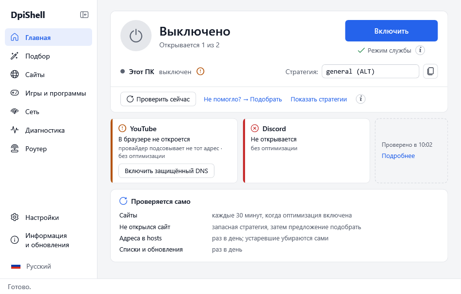 | 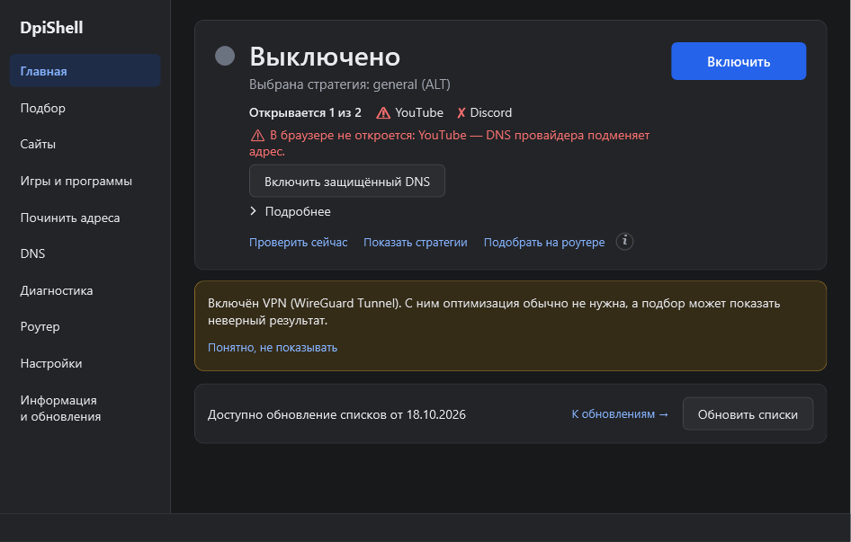 |
| **Подбор** — результат проверки стратегий | 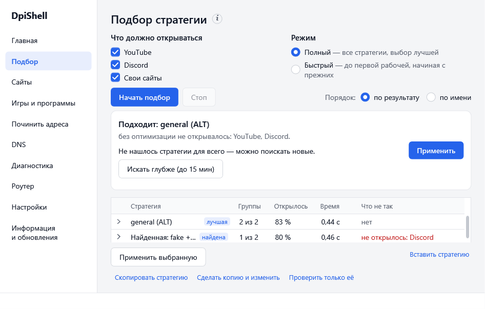 | 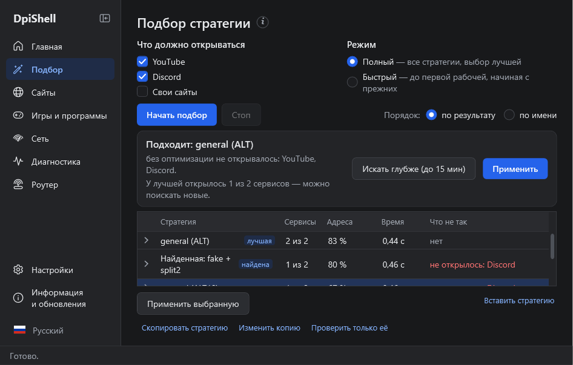 |
| **Сайты** — свои сайты, исключения | 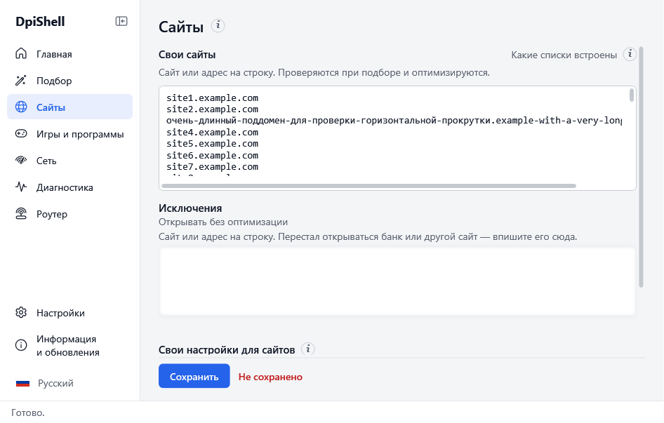 | 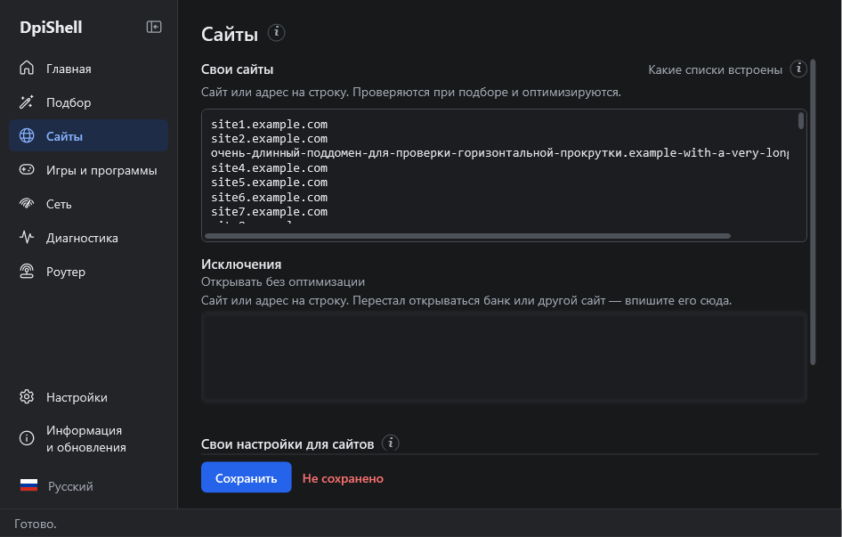 |
| **Игры и программы** — настройка под игру | 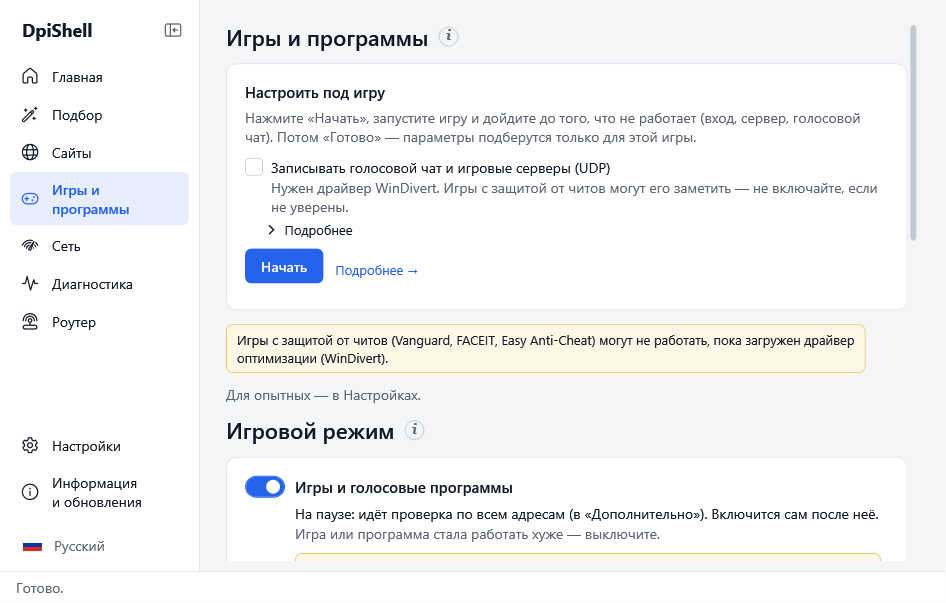 | 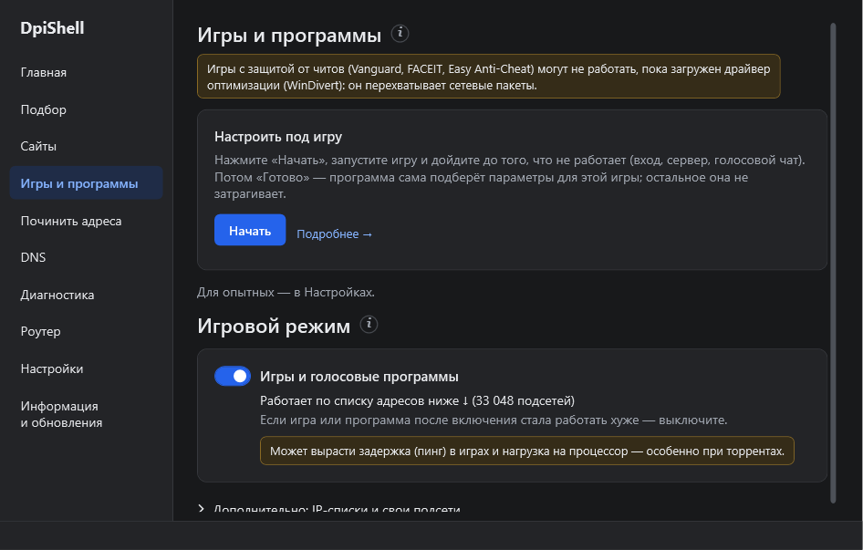 |
| **Сеть** — DNS, прокси, адреса в hosts | 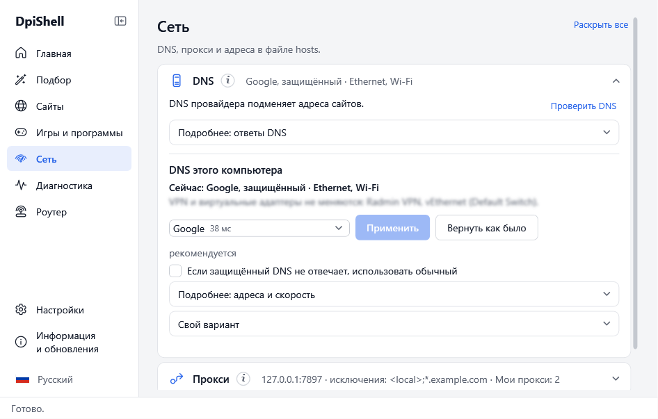 | 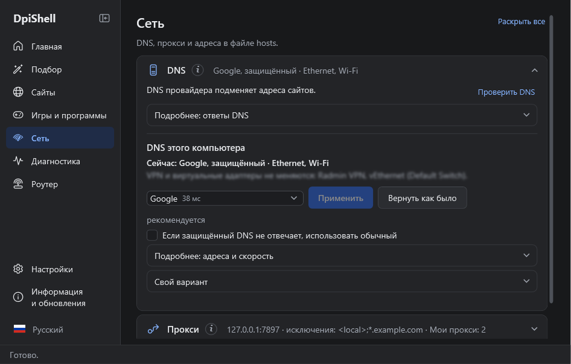 |
| **Роутер** — состояние и действия | 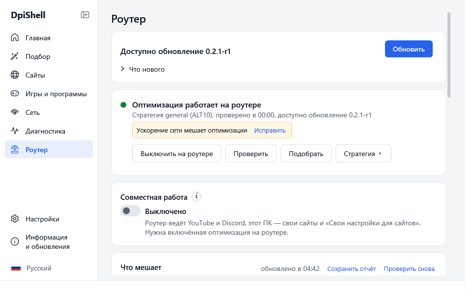 | 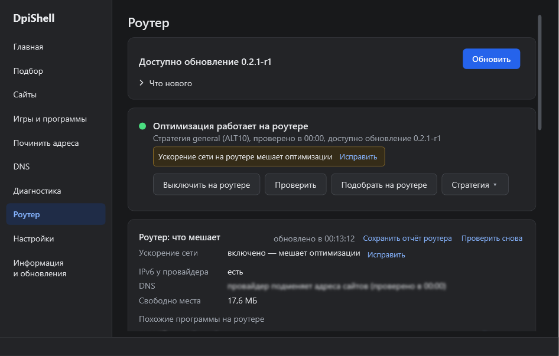 |
| **Настройки** — язык, свои настройки, оформление | 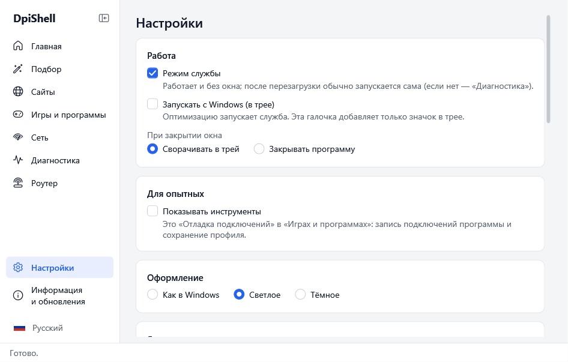 | 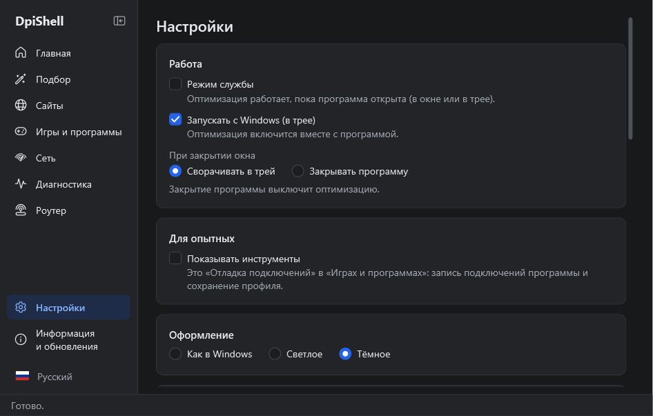 |
| **Информация и обновления** — версии, списки | 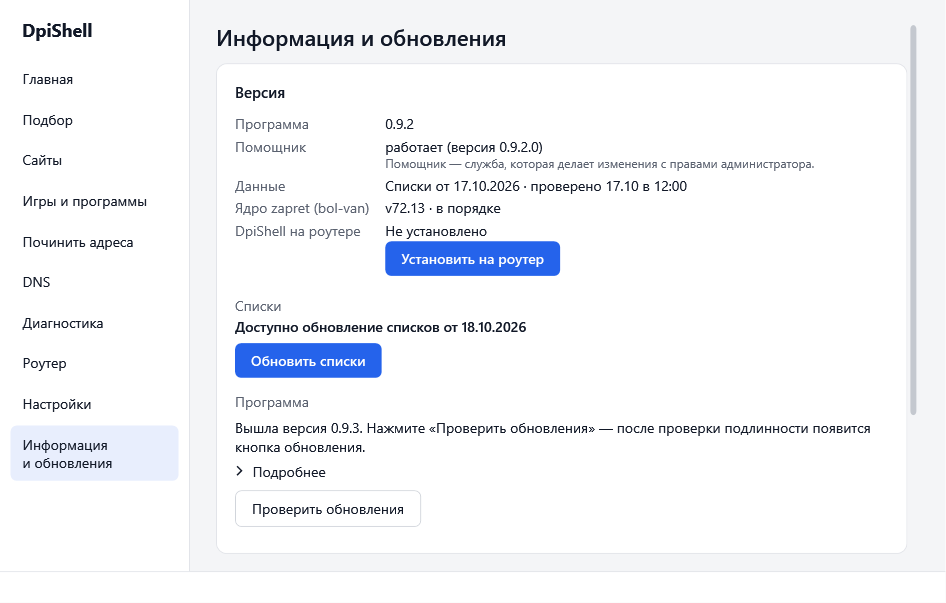 | 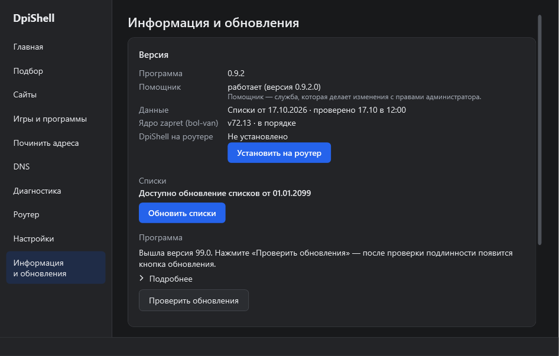 |

Вкладка «Диагностика» — в [docs/screenshots/](docs/screenshots/).

## Скачать (бета)

> [!WARNING]
> ### Антивирусы
> Защитник Windows и другие антивирусы могут счесть угрозой ядро zapret и удалить его — `core.zip` при первом «Включить» или архив `vendor\zapret-v72.13.zip` в архиве исходного кода (Source code на странице выпуска — это не программа; в архиве программы ядра нет). Названия бывают разные: `Trojan:Win32/Tecabans.STV!cl`, `Misleading:Win32/Malgent!AMTB`, `RiskTool…WinDivert`.
>
> Причина — драйвер WinDivert: он перехватывает сетевой трафик, а этим пользуются и вредоносные программы. Сам он не вирус. DpiShell ядро не собирает и не меняет: это [официальный архив zapret v72.13](https://github.com/bol-van/zapret/releases/tag/v72.13) от bol-van, программа сверяет его хеш и хеш каждого файла ([data/core.json](data/core.json), [проверка](docs/vetting.md)).
>
> **Что сделать:** папку ядра `%ProgramData%\DpiShell` добавляет в исключения Защитника кнопка «Добавить в исключения» на «Главной» (только по нажатию, только эту папку; снимается в «Отменить всё»); папку программы — вручную. При первом «Включить» программа спрашивает об исключении сама — после установки помощника, до скачивания ядра. Ядро уже удалено — «Добавить в исключения и восстановить» там же. GitHub не открывается — «Указать архив ядра…» и файл `zapret-core-offline.zip` со страницы выпуска (сверяется тем же sha256). Как именно — [FAQ](docs/FAQ.md#антивирус-удаляет-файлы). Исключение отключает проверку этих папок; сомневаетесь — не ставьте программу.

1. Откройте [страницу последнего выпуска](https://github.com/Slavdew/dpishell/releases/latest) и скачайте `DpiShell-<версия>-portable.zip`.
2. Распакуйте в любую папку и запустите `DpiShell.exe`. Программа не подписана — Windows SmartScreen может предупредить: «Подробнее» → «Выполнить в любом случае». Если такой кнопки нет — запуск, возможно, ограничивает Smart App Control или политика организации.
3. Нажмите «Включить». Подробно — [docs/windows/README.md](docs/windows/README.md).

Это бета: если что-то не работает, [напишите](https://github.com/Slavdew/dpishell/issues), что видели (лучше со снимком экрана). Частые вопросы и «Как вернуть как было» (откат каждой функции, в том числе без окна и без интернета) — [docs/FAQ.md](docs/FAQ.md); [English](docs/FAQ.en.md).

**Совместимость.** Гарантируется работа версий одного выпуска: окно на ПК, помощник и пакеты на роутере. Если долго не обновлять одно (например, окно на ПК), а обновлять другое (роутер), полная работа не гарантируется — обновляйте оба. По возможности совместимость сохраняется.

## Разработчикам

- [Устройство обоих продуктов](docs/dev/architecture.md) — данные, подбор, безопасность, что планируется.
- [Сборка, тесты, публикация](docs/dev/building.md).
- [Договор с роутером](docs/dev/router-api.md), [протокол окно ↔ помощник](docs/dev/helper-protocol.md).
- [Проверка заимствованного](docs/vetting.md) — источники, хеши, лицензии.
- Исследования: [какие бывают движки оптимизации соединения под Windows и почему zapret v1](docs/research/bypass-engines.md), [DpiShell на роутере](docs/research/router-openwrt.md) и [заметки по nfqws на OpenWrt](docs/research/router-nfqws.md), [функции Flowseal: игровой режим, IP-списки, hosts](docs/research/flowseal-features.md), [DNS и подмена ответов](docs/research/dns.md).
- [Тексты кнопок «(i)»](docs/info-texts.md) — часть продукта, их читает тест.

Папки: `src/` (C#/.NET 10, WPF), `tests/`, `data/` (общие каталог стратегий, цели, списки, манифесты), `packaging/`, `router/`, `vendor/` (резервная копия архива ядра: в выпуск идёт отдельным файлом `zapret-core-offline.zip`, в архив программы не входит).

## Лицензия

DpiShell — [MIT](LICENSE). Сторонние компоненты и их лицензии (zapret — MIT, Flowseal — MIT, WinDivert — LGPLv3/GPLv2, cygwin — LGPLv3, .NET — MIT) — `packaging/THIRD-PARTY-NOTICES.txt`.

## English

DpiShell is a simple shell over [zapret](https://github.com/bol-van/zapret) (bol-van) that optimizes the connection to YouTube, Discord and other sites. Press "Turn on"; on most networks that is enough. If sites still do not open, press "Find strategy": the app tests strategies itself and turns on the best one. No VPN, no telemetry. It is a beta; results depend on the ISP and the network. There are two independent products: a Windows app (this README) and a package for OpenWrt routers ([docs/router/README.md](docs/router/README.md), in Russian). The window and the router page are available in Russian and English.

**Download.** Take `DpiShell-<version>-portable.zip` from the [latest release](https://github.com/Slavdew/dpishell/releases/latest) (Windows 10/11 x64). Unpack it to any folder (not into Temp or OneDrive) and run `DpiShell.exe`. Do not delete or edit the `data` folder next to it.

**SmartScreen.** The app is not signed, so Windows SmartScreen may warn: "More info" > "Run anyway". If there is no such button, launch may be restricted by Smart App Control or an organization policy.

**Antivirus.** Windows Defender and other antivirus software may flag the zapret core and delete it (for example `Trojan:Win32/Tecabans.STV!cl`): `core.zip` on the first "Turn on", or the `vendor\zapret-v72.13.zip` archive inside the source code archive (Source code on the release page is not the program; the program archive has no core). The reason is the WinDivert driver, which intercepts network traffic. DpiShell does not build or modify the core: it is the [official zapret v72.13 archive](https://github.com/bol-van/zapret/releases/tag/v72.13) by bol-van, checked by hash ([data/core.json](data/core.json)). The "Add to exclusions" button on "Home" adds the core folder `%ProgramData%\DpiShell` to Defender exclusions (only when pressed, only this folder; "Undo all" removes it); add the program folder manually. On the first "Turn on" the app asks about the exclusion itself, after the helper is installed and before the core is downloaded. If the core is already deleted, use "Add to exclusions and restore" there. If GitHub does not open, use "Choose core archive…" with `zapret-core-offline.zip` from the release page (checked by the same sha256). Steps: [FAQ](docs/FAQ.en.md#antivirus-deletes-files). An exclusion turns off scanning of these folders; if in doubt, do not install the program.

**First run.** On the first "Turn on" Windows asks for administrator rights once: this installs the DpiShell helper (a Windows service). Later the window works without them; when the helper is updated or removed, Windows asks again. The window language switches with the flag icon at the bottom of the left menu.

**Compatibility.** Versions of one release are guaranteed to work together: the PC app, the helper and the router packages. If you leave one of them without updates for long (for example the PC app) while updating the other (the router), full operation is not guaranteed: update both. Compatibility is kept where possible.

**Uninstall.** Easiest: "Settings" > "DpiShell changes" > "Undo all", then "Settings" > "Cleanup and removal": "Remove optimization service" and "Remove helper"; close the program (tray icon > "Exit") and delete the program folder, `%LocalAppData%\DpiShell` and `%ProgramData%\DpiShell` (the last one needs administrator rights). Steps without the window: [docs/FAQ.en.md](docs/FAQ.en.md#how-to-restore-the-previous-state).

**If something does not work.** "Diagnostics" > "Save report" writes one text file you can read before sending; addresses and names of your PC and network, passwords and tokens are hidden in it. Attach it to an [issue](https://github.com/Slavdew/dpishell/issues) and describe what you did and saw. FAQ, including how to restore the previous state for every feature, with or without the window: [docs/FAQ.en.md](docs/FAQ.en.md).
